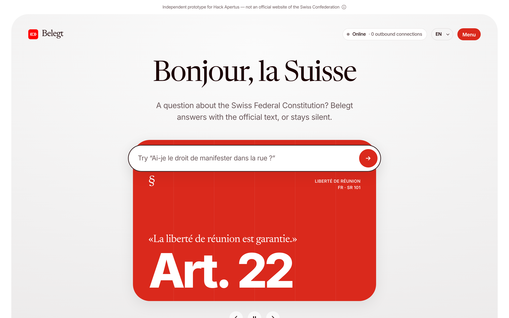

# Belegt — cite or stay silent

**Belegt** (German: *substantiated, documented*) answers questions about the Swiss Federal Constitution **only when it can prove every claim with the official text**. Otherwise it stays silent, and says why. It is built on **Apertus**, the open Swiss LLM, and runs **entirely offline** on an ordinary CPU.

> *Les IA répondent avec aplomb, même quand elles se trompent. Belegt fait l’inverse : il cite, il vérifie, et il préfère se taire plutôt que d’inventer.*

Hack Apertus 2026 · Track 2B “Own Project” · Apache-2.0



## Three promises

| | | How it is enforced |
|---|---|---|
| **Proven** | Every answer comes with exact sentences of the law, highlighted in the official text. | A deterministic verifier (no AI) checks every quote word for word. |
| **Sovereign** | Runs in Switzerland, on hardware you control, with no foreign service. | Local llama.cpp, model weights on disk, an audit hook that blocks and counts any outbound connection; demo runs in a network namespace with no interface. |
| **Measured** | Numbers, not adjectives. | Same model with and without Belegt, 70 questions incl. traps and the same questions in DE/FR/IT/RM, Wilson intervals, raw outputs published. |

## Results (Apertus 1.5 8B, local, temperature 0)

See [`eval/results.md`](eval/results.md) for every item and the raw outputs in `eval/runs/`.

<!-- RESULTS:START -->
<!-- RESULTS:END -->

## Who does what

```
question ──► Apertus (AI) ─────────► rewrites the question in DE / FR / IT / RM with the Constitution's vocabulary
          ──► retrieval (code) ────► BM25 words + char 5-grams over 657 paragraphs × 4 languages, rank fusion
          ──► Apertus (AI) ─────────► drafts 1–3 sentences + picks quotes among 6 candidates (JSON, grammar-constrained)
          ──► verifier (code, no AI)
                R1  the cited paragraph exists in the official text
                R2  the quote appears word for word (typographic normalisation only)
                R3  the quote is long enough to carry meaning (≥ 15 chars)
                R4  no article number in the answer that is not among the verified citations
                R5  no surviving evidence ⇒ abstain, show the closest articles, claim nothing
                X   cross-language agreement: independent search in each language reaches the cited article
          ──► receipt (code) ──────► model + SHA-256, law version + SHA-256, quotes + hashes, checks, network state
```

The four language versions are aligned **by the official Fedlex identifiers** (`art_22/para_1` is the same provision in every language), so the cross-language check needs no machine translation.

## Quick start

Requirements: Python ≥ 3.10 (standard library only), a llama.cpp build, an Apertus GGUF.

```bash
# 1. model + runtime (once)
git clone --depth 1 https://github.com/ggml-org/llama.cpp ../models/llama.cpp
cmake -S ../models/llama.cpp -B ../models/llama.cpp/build -DLLAMA_CURL=OFF && cmake --build ../models/llama.cpp/build -j --target llama-server
curl -L -o ../models/apertus-v1.5-8b-text-q4_k_m.gguf \
  https://huggingface.co/Colby/apertus-v1.5-8b-text-Q4_K_M-GGUF/resolve/main/apertus-v1.5-8b-text-q4_k_m.gguf

# 2. run
scripts/start.sh            # → http://127.0.0.1:8080

# 3. the "cable unplugged" test: whole stack in a network namespace with no interface
sudo scripts/offline_demo.sh
```

The corpus is already built in `data/corpus/`. To rebuild it from the official XML in `data/fedlex/`: `python -m belegt.corpus`.

Evaluation: `python eval/run_eval.py && python eval/score.py`.

## Repository

```
belegt/        corpus.py (Fedlex XML → aligned paragraphs) · retrieve.py · llm.py (local only)
               pipeline.py · verify.py (the rules) · netguard.py (outbound audit) · server.py (stdlib HTTP + SSE)
web/           the interface: tokens.css (design tokens) · app.css · app.js · i18n.js (FR DE IT RM EN) · fonts/
data/fedlex/   official Akoma Ntoso XML of SR 101 (DE FR IT RM, version 2024-03-03)
data/corpus/   parsed, aligned paragraphs + manifest with SHA-256
eval/          questions.jsonl · run_eval.py · score.py · manual_labels.json · results.md · runs/
docs/          design system notes, Devpost texts, deck, video script
scripts/       start.sh · offline_demo.sh · record_replay.py
```

## Design system

The interface reproduces the structure and component system of **America.gov** (2026 redesign: serif display face, 40–48 px rounded hero card, pill composer with a 2 px ink border, chat bubbles, sources sheet, oversized footer wordmark) and recolours it for Switzerland: the blue scale becomes a red scale anchored on **Pantone 485 C** (`#FF0000` for the brand mark, the official digital value; `#DA291C` for actions, which keeps white text at WCAG AA). Proprietary fonts are replaced by open ones served locally (Newsreader, Inter). Hero photographs are replaced by Swiss-Style typographic posters of real articles in the four languages. Details: [`docs/design-system.md`](docs/design-system.md).

Belegt is an independent prototype. It is **not** an official website of the Swiss Confederation and does not use the Swiss coat of arms.

## Known limits

- Not legal advice. Belegt helps find and read the official text.
- The verifier guarantees that quotes exist word for word, **not** that the paraphrase around them is right, nor that the quoted article is the relevant one. Non-quoted sentences are dotted-underlined in the UI; wrong-but-real citations are counted in the evaluation.
- Lexical retrieval sometimes misses the right article; Belegt then abstains (counted as over-refusal) or cites a neighbour (counted as wrong).
- 4-bit 8B model on CPU: about a minute per answer.
- Romansh test questions were written by the team, not by native speakers.

## Credits

Apertus by the Swiss AI Initiative (EPFL, ETH Zurich, CSCS). Text of the Constitution: Fedlex, Swiss Federal Chancellery (official texts are not protected by copyright, Art. 5 URG/LDA). llama.cpp (MIT). Fonts: Newsreader and Inter (SIL OFL 1.1). Design structure inspired by America.gov (U.S. GSA / National Design Studio); no asset of that site is reused.
